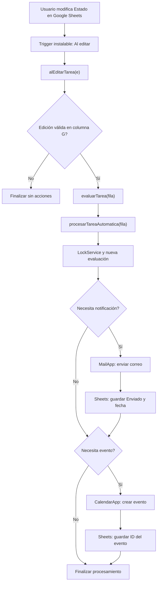

# Arquitectura del sistema — Turing-IA Día 2

## 1. Descripción general

El proyecto implementa una arquitectura basada en eventos utilizando Google Workspace y Google Apps Script.

Google Sheets funciona como repositorio principal de tareas. Google Apps Script contiene la lógica de evaluación y procesamiento, mientras que Gmail y Google Calendar permiten ejecutar las acciones correspondientes.

## 2. Diagrama de arquitectura

## 3. Componentes

| Componente | Responsabilidad |
|---|---|
| Google Sheets | Almacenar tareas y resultados |
| Trigger instalable | Detectar ediciones |
| `alEditarTarea(e)` | Validar el evento e identificar la fila |
| `evaluarTarea(fila)` | Comprobar condiciones de negocio |
| `procesarTareaAutomatica(fila)` | Coordinar y ejecutar las acciones |
| LockService | Reducir conflictos de concurrencia |
| MailApp | Enviar notificaciones |
| CalendarApp | Crear eventos de seguimiento |
| Registros de ejecución | Facilitar el diagnóstico |

## 4. Flujo de datos

1. El usuario modifica individualmente una celda de Estado en la columna G.
2. El trigger ejecuta `alEditarTarea(e)`.
3. Se comprueba que la edición corresponda a la pestaña `Tareas` y a una fila válida.
4. `evaluarTarea(fila)` consulta los datos y determina qué acciones hacen falta.
5. `procesarTareaAutomatica(fila)` obtiene un bloqueo y vuelve a evaluar la tarea.
6. Si corresponde, MailApp envía una notificación y registra el resultado en Sheets.
7. Si corresponde, CalendarApp crea un evento de día completo y guarda su identificador.
8. Se registran los resultados del procesamiento.

## 5. Decisiones de diseño

### Separación de responsabilidades

Se dividió la automatización en funciones diferentes para separar la detección, evaluación y ejecución de acciones.

### Validación de datos

Se comprueban campos obligatorios, fechas y formato del destinatario para reducir errores.

### Prevención de duplicados

Se utilizan los campos `Notificación` e `ID evento` para identificar acciones previamente registradas.

### Control de concurrencia

Se implementó `LockService` para reducir conflictos cuando existen ejecuciones simultáneas.

## 6. Limitaciones

- Solo se procesan automáticamente ediciones individuales en la columna G.
- Los días restantes se actualizan mediante ejecución manual.
- No se actualizan ni eliminan eventos existentes.
- No se garantiza procesamiento exactamente una vez ante fallos parciales.
- Las integraciones utilizan los permisos de la cuenta que autorizó el trigger.