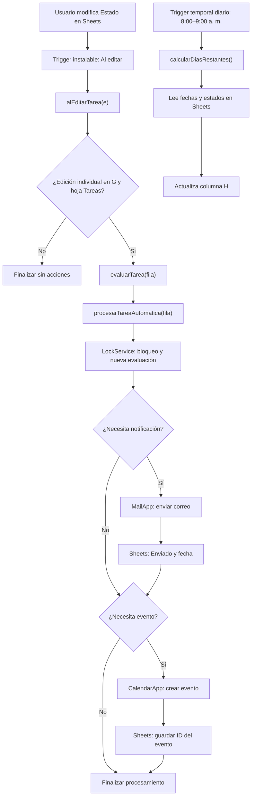

# Arquitectura del sistema — Turing-IA Día 2

## 1. Descripción general

El proyecto utiliza Google Sheets como repositorio principal de tareas, Google Apps Script como lógica de automatización y Gmail y Google Calendar como canales de acción.

La arquitectura contempla dos flujos de automatización independientes:

- **Activador de edición:** procesa modificaciones en el estado de las tareas para generar notificaciones y eventos.
- **Activador temporal diario:** programa la ejecución de `calcularDiasRestantes()` para actualizar los vencimientos en Google Sheets.

Esta separación permite mantener responsabilidades específicas para cada proceso.

## 2. Diagrama de arquitectura

## 3. Componentes

| Componente | Responsabilidad |
|---|---|
| Google Sheets | Almacenar tareas, vencimientos y resultados |
| Trigger instalable de edición | Detectar ediciones individuales de Estado (columna G) |
| `alEditarTarea(e)` | Validar evento, hoja, fila y columna |
| `evaluarTarea(fila)` | Decidir si hacen falta notificación o evento |
| `procesarTareaAutomatica(fila)` | Coordinar operaciones y ejecutarlas |
| `LockService` | Reducir conflictos entre ejecuciones simultáneas |
| `MailApp` | Enviar notificaciones de tareas urgentes |
| `CalendarApp` | Crear eventos de seguimiento |
| Trigger temporal diario | Programar la actualización diaria de vencimientos |
| `calcularDiasRestantes()` | Calcular días restantes y escribirlos en H |
| Registros de Apps Script | Facilitar la revisión de ejecuciones y errores |

## 4. Flujo de edición

1. El usuario modifica una celda de Estado (G) en `Tareas`.
2. `alEditarTarea(e)` comprueba la edición y determina la fila.
3. `evaluarTarea(fila)` consulta y valida la tarea.
4. `procesarTareaAutomatica(fila)` obtiene un bloqueo y vuelve a evaluar.
5. Si corresponde, `MailApp` envía correo y registra `Enviado` y la fecha en las columnas I y K.
6. Si corresponde, `CalendarApp` crea un evento de día completo y guarda su ID en la columna J.
7. Se registran mensajes de ejecución para facilitar el seguimiento.

## 5. Flujo temporal diario

1. Se establece un activador basado en tiempo con frecuencia diaria, dentro del intervalo de **8:00 a 9:00 a. m.**
2. El activador está asociado a `calcularDiasRestantes()`.
3. La función consulta los identificadores, fechas límite y estados registrados en Google Sheets.
4. Para cada tarea válida calcula los días restantes; identifica las tareas completadas y las fechas inválidas.
5. Actualiza la columna H con los resultados.
6. Registra la finalización del procesamiento mediante los registros de Apps Script.

El horario corresponde a una ventana de ejecución programada y no a una hora exacta.

La función `calcularDiasRestantes()` fue ejecutada manualmente con resultados satisfactorios para las tareas T001–T007.

## 6. Decisiones de diseño

### Separación de responsabilidades

El sistema divide la detección, evaluación y ejecución de acciones en funciones independientes.

El cálculo diario utiliza un activador separado del procesamiento de cambios de estado.

### Validaciones

Se comprueba la existencia de la hoja, la validez de las filas, los campos obligatorios, las fechas y el formato del correo cuando corresponde.

### Prevención de duplicados

Se consultan las columnas I (`Enviado`) y J (ID del evento) antes de ejecutar acciones externas.

### Control de concurrencia

Se utiliza `LockService` para reducir conflictos entre ejecuciones simultáneas del procesamiento de tareas.

### Reutilización del código

El activador temporal utiliza la función `calcularDiasRestantes()` desarrollada previamente, sin necesidad de modificar su lógica.

### Independencia de los activadores

- El activador de edición ejecuta las reglas de Gmail y Calendar.
- El activador temporal actualiza los cálculos de vencimiento en Sheets.

De esta forma, las tareas de mantenimiento diario no provocan envíos de correos ni creación de eventos.

## 7. Limitaciones

- Las notificaciones y los eventos se procesan automáticamente cuando se edita individualmente una celda de la columna G.
- El activador temporal se encarga únicamente del cálculo de días restantes; no envía recordatorios por correo.
- No se actualizan ni eliminan eventos existentes cuando cambia una fecha o se completa una tarea.
- No se garantiza procesamiento exactamente una vez ante fallos parciales.
- Los activadores utilizan los permisos de la cuenta de Google que los creó y autorizó.
- La administración empresarial de usuarios, grupos y políticas de Google Workspace se encuentra fuera del alcance de la implementación realizada.